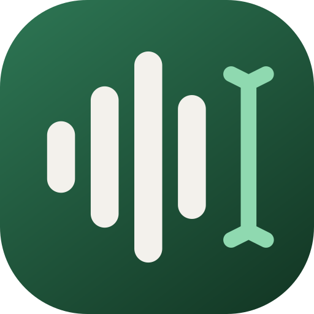
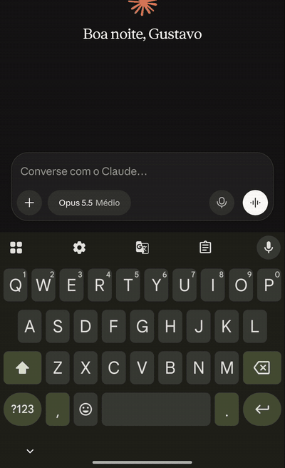
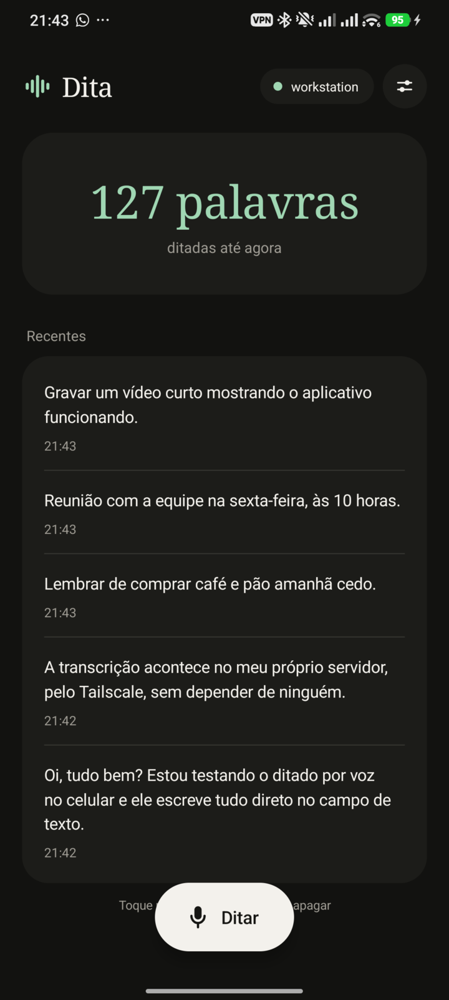
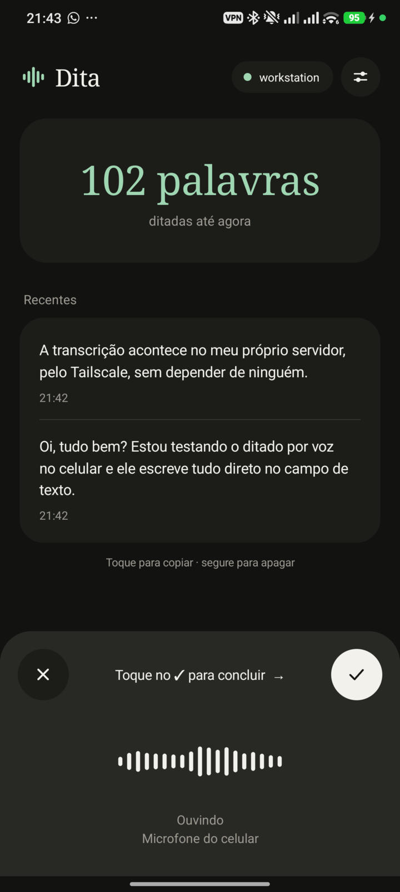
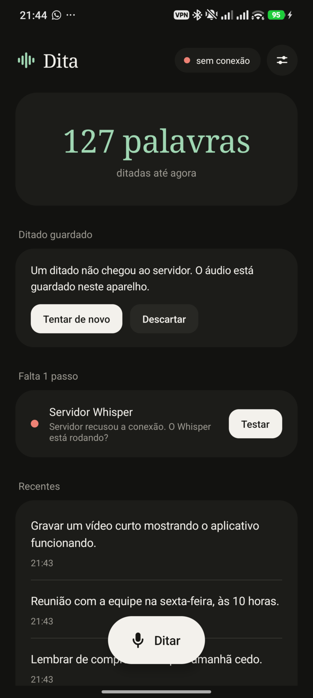
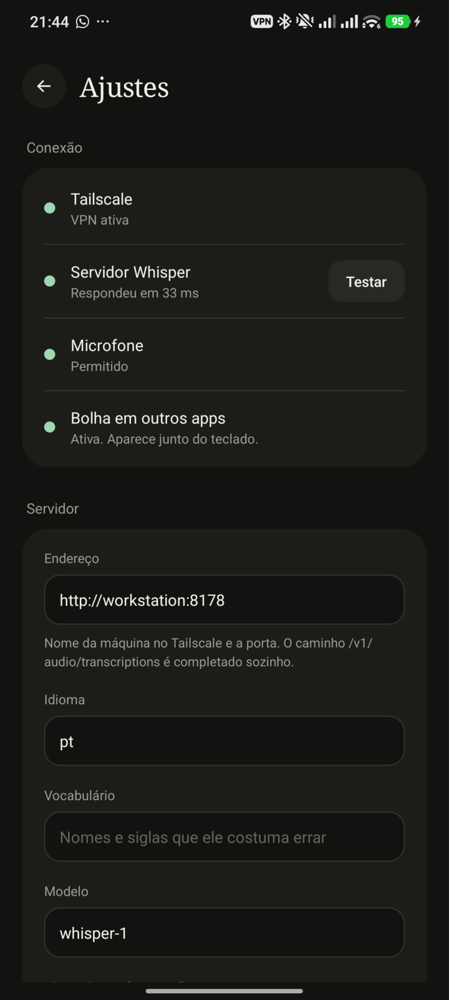

<p align="center"></p>

<h1 align="center">Dita</h1>

<p align="center">
Ditado por voz para Android, no estilo do Wispr Flow, usando o <b>seu</b> servidor Whisper.<br>
Fale em qualquer app. O áudio vai do celular direto para o seu endpoint, normalmente dentro do Tailscale.
</p>

<p align="center"></p>

## O que ele faz

- **Bolha flutuante em qualquer app.** Aparece junto do teclado. Toque para ditar e toque de novo
  para concluir, ou segure, fale e solte. O texto entra no campo, na posição do cursor.
- **Seu servidor, sua rede.** Fala o formato da OpenAI (`POST /v1/audio/transcriptions`). Funciona com
  whisper.cpp, Speaches, LocalAI, OpenAI e Groq.
- **Não perde ditado.** Se o servidor não responder, o áudio fica guardado no aparelho para reenviar.
- **Servidor reserva** opcional, usado só quando o principal falha.
- **Vocabulário e substituições** para nomes e siglas que o Whisper costuma errar.
- **Limpeza por LLM** opcional (desligada por padrão): tira "é…", "tipo" e autocorreções faladas.
- **Discreto.** A bolha não aparece em campos de senha e pode ser escondida em apps específicos.
- **Leve.** Kotlin nativo, sem bibliotecas. O APK tem cerca de 60 KB.
- Sem conta, sem cadastro, sem telemetria. Histórico só no aparelho.

<p align="center">




</p>

## Como usar

1. Tenha um servidor Whisper acessível pelo celular. Com whisper.cpp:
   ```sh
   whisper-server --host "$(tailscale ip -4)" --port 8178 \
     -m ggml-large-v3.bin -l pt --inference-path /v1/audio/transcriptions
   ```
2. Ligue o Tailscale no celular.
3. Instale o Dita, abra os ajustes e informe o endereço, por exemplo `http://workstation:8178`.
   O caminho `/v1/audio/transcriptions` é completado sozinho.
4. Permita o microfone e ative **Dita — bolha de ditado** em Acessibilidade.

| Servidor | Endereço | Modelo |
|---|---|---|
| whisper.cpp | `http://host:8178` | qualquer |
| OpenAI | `https://api.openai.com` | `whisper-1` |
| Groq | `https://api.groq.com/openai/v1` | `whisper-large-v3` |

O áudio é enviado como WAV 16 kHz mono, com limite de 10 minutos por ditado.

## Compilar

Requer JDK 17 e Android SDK (platform 36, build-tools 35).

```sh
echo "sdk.dir=$HOME/Android/Sdk" > local.properties
./gradlew assembleRelease
adb install -r app/build/outputs/apk/release/app-release.apk
```

Sem `keystore.properties`, o build de release é assinado com a chave de debug. Para usar chave
própria, crie `keystore.properties` na raiz com `storeFile`, `storePassword`, `keyAlias` e `keyPassword`.

## Privacidade e permissões

- **Acessibilidade:** usada só para saber se há um campo de texto em foco, posicionar a bolha e
  inserir o texto ditado. O Dita não guarda nem envia o conteúdo da tela.
- **Microfone:** grava apenas enquanto você dita.
- **Rede:** o áudio vai somente para os endereços que você configurou. HTTP sem TLS é aceito porque
  o uso previsto é dentro do túnel do Tailscale; fora dele, use `https://`.

## Licença

[MIT](LICENSE). Projeto independente, sem relação com o Wispr Flow.
